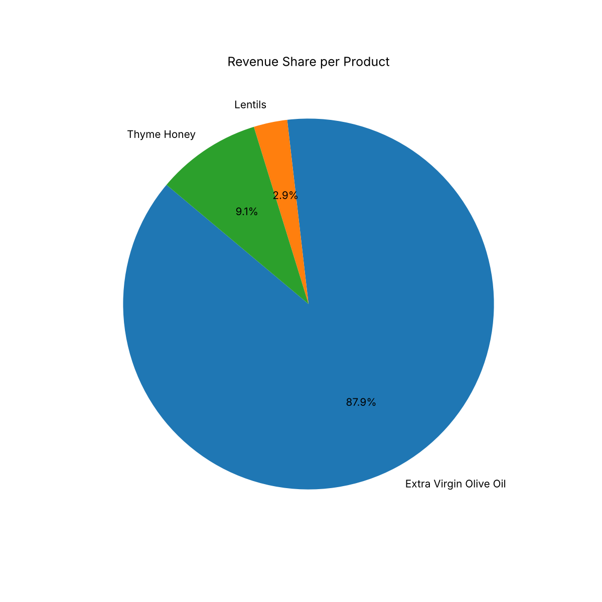
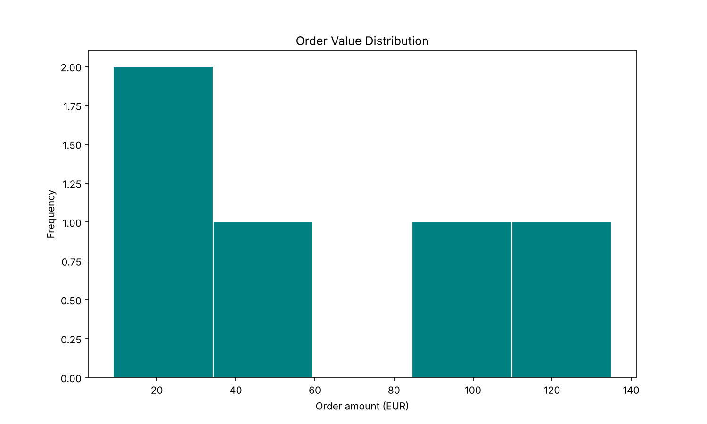
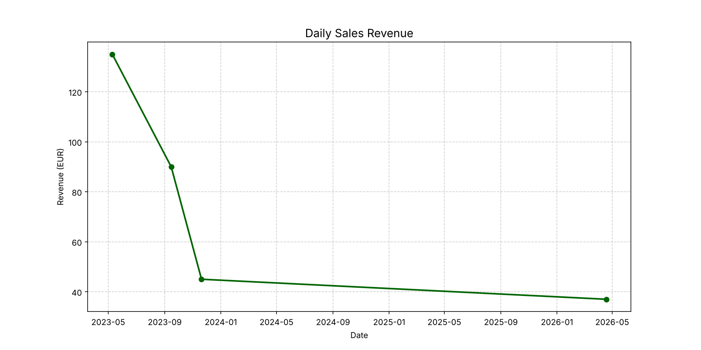

# SQL & Business Intelligence – E-shop Database

A relational database for an agricultural-products e-shop, with business rules automated in SQL and a Python analytics layer for KPIs and reporting.

*Academic project – MSc Business Mathematics (NKUA & AUEB), course: Data Management & Business Intelligence.*

## What it does

| Layer | Implementation |
|---|---|
| **Data model** | Normalized MySQL schema with 5 tables (`Customers`, `Products`, `Orders`, `OrderItems`, `SalesStats`) and primary/foreign-key constraints. `DECIMAL` is used for monetary fields. |
| **Views** | `AvailableProducts` (in-stock catalogue), `TodaysOrders`, `TopCustomers` (ranked by total spend) and `InvoiceData` (4-table JOIN at line level) |
| **Business rules (trigger)** | On every new order line the trigger **automatically decrements inventory** and applies a **10% loyalty discount** to customers who spent more than €200 in the last 12 months |
| **Scheduled job (event)** | `daily_sales_summary` runs every day at 00:05 and loads the previous day's total sales into `SalesStats` (a small automated ETL/reporting step) |
| **Excel integration** | Workbook connected to the database: select a customer from a drop-down list and the invoice is populated automatically with `XLOOKUP` (Greek-language template) |
| **Python analytics** | pandas `read_sql` on the `InvoiceData` view: revenue mix, order-value distribution, daily revenue trend and KPIs |

## KPIs computed

- Total revenue
- Average order value (AOV)
- Repeat-customer rate

## Charts

| Revenue share per product | Order value distribution |
|---|---|
|  |  |



## Repository structure

```
sql/schema.sql            # tables, sample data, views, trigger, scheduled event
python/sales_analysis.py  # KPI and chart generation
excel/invoice_template.xlsx
images/                   # generated charts
```

## How to run

```bash
mysql -u root -p < sql/schema.sql
pip install -r requirements.txt
export DB_USER=root DB_PASSWORD=your_password
python python/sales_analysis.py
```

## Tech stack
MySQL · SQL (DDL, JOINs, aggregations, views, triggers) · Python · pandas · matplotlib · Excel
